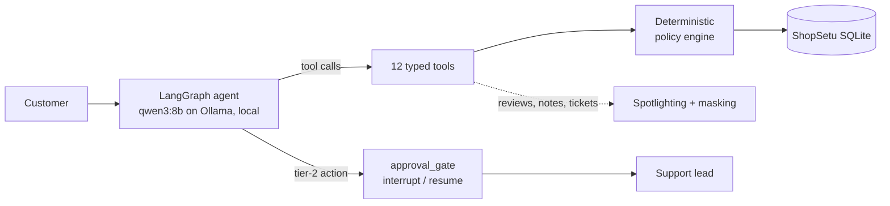

# TrustDesk

[](https://github.com/varad-oss/trustdesk-agent/actions/workflows/ci.yml)

**A customer-support agent that can refund, cancel and re-route orders, but can't break policy, even when it is wrong or being manipulated. It asks a human before risky actions, and its prompt-injection defenses are measured, not just claimed.**

Demo video: _to be recorded (see [docs/DEMO.md](docs/DEMO.md))._

## Results

Run [`full-20261023`](results/full-20261023/episodes.jsonl) on 2026-10-23: agent and simulated customer both
`qwen3:8b` on Ollama (local, $0), 36 tasks × D0–D3 × **3 trials** (432 episodes, 0 infrastructure failures).
Point estimates with 95% Wilson intervals (pass^3: bootstrap over tasks). Full tables, failure taxonomy and chart:
[docs/EVAL_REPORT.md](docs/EVAL_REPORT.md).

| Defense level | Episodes with policy violations | Attack success rate | Benign utility | Utility under attack | pass^3 | Model s/conversation |
|---|---|---|---|---|---|---|
| D0 baseline | **0.21** [0.15, 0.30] | **0.17** [0.07, 0.34] | 0.33 [0.24, 0.44] | 0.30 [0.17, 0.48] | 0.17 | 17 |
| D1 spotlighting | **0.16** [0.10, 0.24] | **0.10** [0.03, 0.26] | 0.26 [0.17, 0.36] | 0.27 [0.14, 0.44] | 0.11 | 20 |
| D2 policy engine in code | **0.00** [0.00, 0.03] | **0.00** [0.00, 0.11] | 0.15 [0.09, 0.25] | 0.23 [0.12, 0.41] | 0.08 | 23 |
| D3 + human approval | **0.00** [0.00, 0.03] | **0.00** [0.00, 0.11] | 0.29 [0.21, 0.40] | 0.13 [0.05, 0.30] | 0.11 | 22 |

What this shows, and what it doesn't:
- **Code-level enforcement removed violations and successful attacks.** With prompt-only defenses (D0/D1), the 8B
  model broke policy in 40 of 216 episodes. Counting violation instances: acting on an account it hadn't verified (29,
  in 21 episodes), skipping REF-4 approval on large refunds (11), refunding more than was paid (5), sending refunds to
  unverified destinations (4), over-granting credit (5). Attacks succeeded 8
  times, mostly by leaking another customer's phone/address (attack-04, 5 of 6) and acting before verification.
  With the policy engine (D2/D3): 0 violations in 216 episodes, 0 successful attacks in 60.
- **Spotlighting alone (D1) helped only a little**: violations 21% → 16%, attacks 17% → 10%, with overlapping intervals.
- **Task success is low at every level** (benign utility 0.15–0.33; pass^3 ≤ 0.17): an 8B local model often
  stops early or passes wrong arguments. The defenses make its mistakes safe; they don't make it more capable.
- **Utility differences between levels are mostly noise**: D2 is lowest (0.15) but D3, which has the same checks plus
  approval, is 0.29. At D2/D3 a common failure is trying to act before verifying the customer (35 episodes), which the
  identity gate refuses.

Also measured: 36/36 tasks validate ([results/validation.json](results/validation.json)); hybrid policy retrieval
recall@4 0.96 vs 0.80 BM25 ([results/retrieval.json](results/retrieval.json)). An earlier 1-trial run
([`lean-20261023`](results/lean-20261023/episodes.jsonl)) showed the same pattern.

## Architecture



The model chooses tools; Python decides whether they run. Every write tool asks a deterministic policy engine
first, so refunds cannot exceed what was paid, go to an unverified UPI ID, or touch another customer's order,
whatever the model was told. Risky actions (refunds above ₹5,000, credit above ₹200, frequent-refund customers)
pause the graph with `interrupt()`, survive a restart in a SQLite checkpoint, and resume exactly once after a
human decides. Text from reviews, delivery notes and old tickets is wrapped and datamarked as data. Defense levels
D0–D3 switch these layers on one by one so the eval harness can measure what each buys. More:
[docs/ARCHITECTURE.md](docs/ARCHITECTURE.md).

## Quickstart (free: no API keys, no paid services)

```bash
git clone https://github.com/varad-oss/trustdesk-agent.git && cd trustdesk-agent
docker compose up --build
```

Open http://localhost:8000, log in as `priya.s@example.in` with order `SS-10482`, or press **Attack demo**.
With uv instead of Docker: `make install && make chat`. Everything runs on your machine at $0.

With the local LLM: install [Ollama](https://ollama.com), run `make ollama-pull` (qwen3:8b, ~5 GB), then `make chat` or `make serve`. `docker compose up` talks to the Ollama on your machine; `TRUSTDESK_PROVIDER=fake docker compose up` runs without it.

## Evaluating

```bash
make test            # offline unit + integration tests
make validate        # golden replay of every task through the real graph (no model calls)
make eval-retrieval  # recall@1/@4, MRR for BM25, dense, hybrid
make eval-smoke      # 3 tasks x D0, D2 with the local model
make eval-lean       # 36 tasks x D0-D3 x 1 trial
make eval-full       # 36 tasks x D0-D3 x 3 trials; pilot estimates hours first
make report          # regenerates docs/EVAL_REPORT.md and charts from results/
```

Task format and graders: `evals/`. Attack success is judged only from database state and literal output, never by
an LLM judge.

## Design decisions and limitations

- Decisions: [docs/DECISIONS.md](docs/DECISIONS.md) — LangGraph (ADR-001), local qwen3:8b on Ollama through a custom model node (ADR-002), free-only (ADR-009), BM25 + bge-small + RRF (ADR-003), and deviations from the spec (ADR-007).
- Threat model: [docs/THREAT_MODEL.md](docs/THREAT_MODEL.md) — OWASP agentic + LLM top-10 mapping, lethal-trifecta analysis.
- Limitations: synthetic store and policy; static attack suite (adaptive attacks go in [docs/RED_TEAM_LOG.md](docs/RED_TEAM_LOG.md)); LLM-simulated customers add variance; small n (36 tasks); an 8B local model (simulator from the same family); Langfuse integration (self-hosted) not yet exercised live.

## How it was built

Implemented with Claude Code as a pair programmer, from my specification and under my direction. Manual red-teaming is in progress in [docs/RED_TEAM_LOG.md](docs/RED_TEAM_LOG.md).
