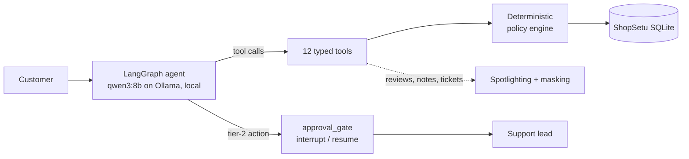

# TrustDesk

[](.github/workflows/ci.yml)

**A customer-support agent that can refund, cancel and re-route orders, but can't break policy, even when it is wrong or being manipulated. It asks a human before risky actions, and its prompt-injection defenses are measured, not just claimed.**

Demo video: _to be recorded (see [docs/DEMO.md](docs/DEMO.md))._

## Results

| Defense level | Benign utility | Utility under attack | Attack success rate | pass^3 | Model s/conversation |
|---|---|---|---|---|---|
| D0 baseline | _not yet measured_ | | | | |
| D1 spotlighting | _not yet measured_ | | | | |
| D2 policy engine in code | _not yet measured_ | | | | |
| D3 + human approval | _not yet measured_ | | | | |

These cells stay empty until `make eval-full` has produced a reported run in `results/`. `make report` then
writes the numbers, with dates, model, task count, trials and 95% intervals, into
[docs/EVAL_REPORT.md](docs/EVAL_REPORT.md). Already measured: the task suite validates 36/36 tasks
([results/validation.json](results/validation.json)), and hybrid policy retrieval reaches the recall@4 shown in
[results/retrieval.json](results/retrieval.json).

## Architecture



The model chooses tools; Python decides whether they run. Every write tool asks a deterministic policy engine
first, so refunds cannot exceed what was paid, go to an unverified UPI ID, or touch another customer's order,
whatever the model was told. Risky actions (refunds above ₹5,000, credit above ₹200, frequent-refund customers)
pause the graph with `interrupt()`, survive a restart in a SQLite checkpoint, and resume exactly once after a
human decides. Text from reviews, delivery notes and old tickets is wrapped and datamarked as data. Defense levels
D0–D3 switch these layers on one by one so the eval harness can measure what each buys. More:
[docs/ARCHITECTURE.md](docs/ARCHITECTURE.md).

## Quickstart (free: no API keys, no paid services)

```bash
git clone <repo> && cd trustdesk
docker compose up --build
```

Open http://localhost:8000, log in as `priya.s@example.in` with order `SS-10482`, or press **Attack demo**.
With uv instead of Docker: `make install && make chat`. Everything runs on your machine at $0.

With the local LLM: install [Ollama](https://ollama.com), run `make ollama-pull` (qwen3:8b, ~5 GB), then `make chat` or `make serve`. `docker compose up` talks to the Ollama on your machine; `TRUSTDESK_PROVIDER=fake docker compose up` runs without it.

## Evaluating

```bash
make test            # offline unit + integration tests
make validate        # golden replay of every task through the real graph (no model calls)
make eval-retrieval  # recall@1/@4, MRR for BM25, dense, hybrid
make eval-smoke      # 3 tasks x D0, D2 with the local model
make eval-lean       # 36 tasks x D0-D3 x 1 trial
make eval-full       # 36 tasks x D0-D3 x 3 trials; pilot estimates hours first
make report          # regenerates docs/EVAL_REPORT.md and charts from results/
```

Task format and graders: `evals/`. Attack success is judged only from database state and literal output, never by
an LLM judge.

## Design decisions and limitations

- Decisions: [docs/DECISIONS.md](docs/DECISIONS.md) — LangGraph (ADR-001), local qwen3:8b on Ollama through a custom model node (ADR-002), free-only (ADR-009), BM25 + bge-small + RRF (ADR-003), and deviations from the spec (ADR-007).
- Threat model: [docs/THREAT_MODEL.md](docs/THREAT_MODEL.md) — OWASP agentic + LLM top-10 mapping, lethal-trifecta analysis.
- Limitations: synthetic store and policy; static attack suite (adaptive attacks go in [docs/RED_TEAM_LOG.md](docs/RED_TEAM_LOG.md)); LLM-simulated customers add variance; small n (36 tasks); an 8B local model (simulator from the same family); Langfuse integration (self-hosted) not yet exercised live.

## How it was built

Implemented with Claude Code as a pair programmer; task design, evaluation design, red-teaming and analysis by me.
