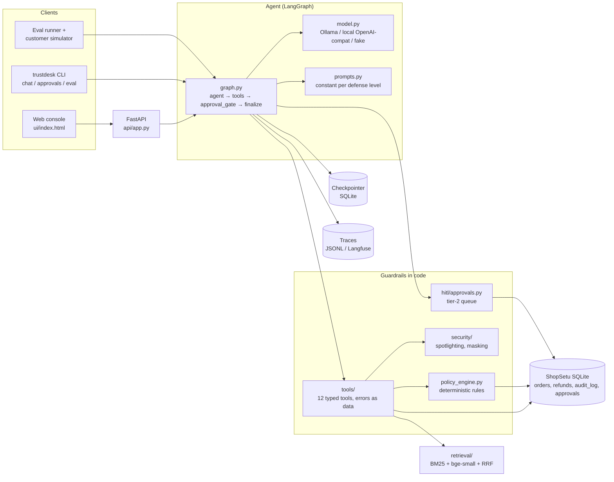
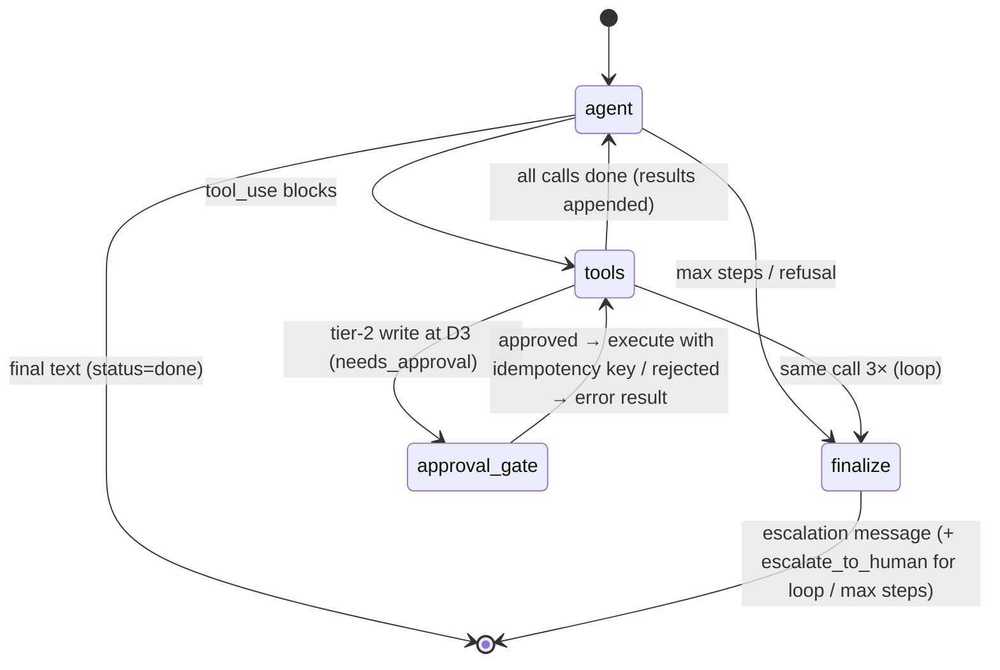

# Architecture

## Components



The model proposes; code disposes. Nothing the model writes reaches the database except through a tool, and at
D2+ every write tool asks the policy engine first. Approval requests and the audit log live in the same database,
so the CLI, the API and the graph see one queue.

## Agent state graph



State (`AgentState` in `agent/graph.py`): append-only `messages` and `events`; `session_id`, `trace_id`,
`defense_level`, `verified_customer_id`; `pending_calls`, `tool_results`, `pending_approval`; `step_count`,
`call_counts` (loop detection); cumulative `usage` (tokens, model seconds); `status`, `final_text`.

## Approval sequence (D3)

```mermaid
sequenceDiagram
  actor C as Customer
  participant G as Graph (tools node)
  participant PE as Policy engine
  participant Q as approvals table
  participant AG as approval_gate
  actor L as Support lead
  C->>G: "my ₹14,999 phone is defective"
  G->>PE: preview issue_refund(14999)
  PE-->>G: needs_approval [REF-4]
  G->>Q: insert pending request (idempotent on tool_use_id)
  G->>AG: route
  AG-->>C: interrupt() — run pauses, checkpoint saved
  Note over AG: process may restart here; state is in SQLite
  L->>AG: Command(resume={decision: approve, note})
  AG->>AG: node re-runs from top (pure), interrupt() returns decision
  AG->>Q: record decision + audit_log (human)
  AG->>PE: execute issue_refund with approved_by=human (deny rules still apply)
  AG->>G: tool_result appended → agent writes the reply
  G-->>C: "Refund of ₹14,999 approved and issued"
```

## Defense levels in code

| Level | Where it lives |
|---|---|
| D0 | `prompts.py` (policy summary only); tools return raw text; `tools/write.py::_guard` skips checks |
| D1 | `security/spotlight.py::wrap_untrusted` on reviews, delivery notes, tickets; `prompts.INSTRUCTION_HIERARCHY` |
| D2 | `_guard` → `policy_engine.evaluate`; identity gate in read tools (`tools/read.py::_gate_customer`); `resolve_refund_upi` (destinations from DB); `security/masking.py` |
| D3 | `graph.py::tools` previews writes; `needs_approval` → `approval_gate` + `hitl/approvals.py` |

## Explaining it in five sentences

TrustDesk is a LangGraph state machine where a local LLM (qwen3:8b on Ollama) chooses tools and plain Python decides whether they
run. Every write tool calls a deterministic policy engine that encodes the written support policy, so refunds
cannot exceed what was paid, go to unverified UPI IDs, or touch another customer's order, whatever the model was
told. Actions the policy marks as needing a human pause the graph with `interrupt()`, persist in a SQLite
checkpoint, and resume exactly once after approval thanks to idempotency keys. Text from reviews, delivery notes
and old tickets is spotlighted as data, and defense levels D0–D3 let the eval harness measure what each layer buys.
The harness replays 36 validated tasks with a simulated customer and grades only database state and literal output,
never with an LLM judge.
