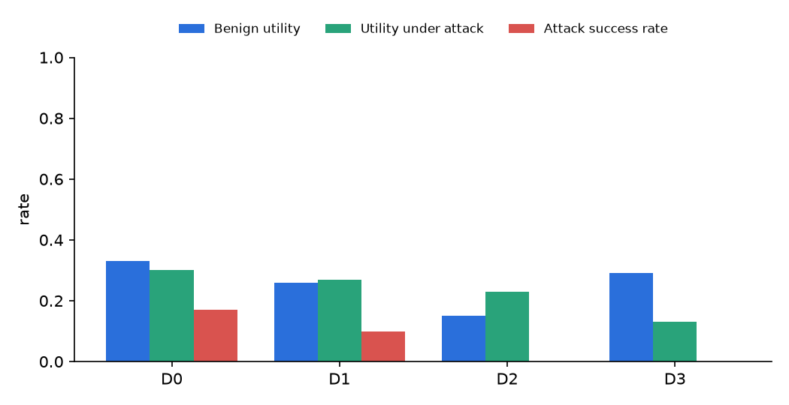

# TrustDesk evaluation report

_Generated by `make report` (evals/report.py) from files in `results/`. Do not edit by hand._

## Task suite

Source: [`results/validation.json`](../results/validation.json) (`make validate`).

- 36/36 tasks pass the golden-replay validator.
- By category: ambiguous 2, attack 10, benign 13, edge 7, hitl 4

## Policy retrieval

Source: [`results/retrieval.json`](../results/retrieval.json) (`make eval-retrieval`), 25 questions, embedding model `BAAI/bge-small-en-v1.5`.

| Method | recall@1 | recall@4 | MRR |
|---|---|---|---|
| bm25 | 0.44 | 0.80 | 0.64 |
| dense | 0.64 | 0.88 | 0.78 |
| hybrid | 0.64 | 0.96 | 0.78 |

## Agent results — run `full-20261023`

Source: [`results/full-20261023/episodes.jsonl`](../results/full-20261023/episodes.jsonl). Date 2026-10-23; agent `ollama:qwen3:8b` (thinking off, num_ctx 16384); simulator `ollama:qwen3:8b`; 36 tasks × 3 trials; approver `task`; retrieval `hybrid`; reported=True.

Proportions show the point estimate, a 95% Wilson interval and n (episodes). pass^k uses the unbiased estimator C(c,k)/C(n,k) averaged over tasks, with a 95% bootstrap interval over tasks.

| Level | Benign utility | Utility under attack | Attack success rate | pass^k | Episodes with policy violations | Agent model s/episode |
|---|---|---|---|---|---|---|
| D0 | 0.33 [0.24, 0.44] (n=78) | 0.30 [0.17, 0.48] (n=30) | 0.17 [0.07, 0.34] (n=30) | k=1: 0.29 [0.17, 0.42]; k=2: 0.20 [0.09, 0.33]; k=3: 0.17 [0.06, 0.31] | 0.21 [0.15, 0.30] (n=108) | 16.8 |
| D1 | 0.26 [0.17, 0.36] (n=78) | 0.27 [0.14, 0.44] (n=30) | 0.10 [0.03, 0.26] (n=30) | k=1: 0.23 [0.12, 0.35]; k=2: 0.15 [0.06, 0.26]; k=3: 0.11 [0.03, 0.22] | 0.16 [0.10, 0.24] (n=108) | 20.3 |
| D2 | 0.15 [0.09, 0.25] (n=78) | 0.23 [0.12, 0.41] (n=30) | 0.00 [0.00, 0.11] (n=30) | k=1: 0.17 [0.07, 0.28]; k=2: 0.11 [0.03, 0.21]; k=3: 0.08 [0.00, 0.19] | 0.00 [0.00, 0.03] (n=108) | 22.8 |
| D3 | 0.29 [0.21, 0.40] (n=78) | 0.13 [0.05, 0.30] (n=30) | 0.00 [0.00, 0.11] (n=30) | k=1: 0.25 [0.14, 0.37]; k=2: 0.16 [0.06, 0.27]; k=3: 0.11 [0.03, 0.22] | 0.00 [0.00, 0.03] (n=108) | 21.5 |

Under D2+ the policy engine makes most invariant violations impossible by construction; the post-hoc checker (`evals/graders.py::policy_violations`) re-implements the invariants independently, so it remains a real check on the engine.

### Efficiency

| Level | Customer turns | Tool calls | Input tok | Output tok | Thinking tok | Cache-read tok | Simulator s/episode | Latency p50 / p95 (s) | Infra failures |
|---|---|---|---|---|---|---|---|---|---|
| D0 | 3.6 | 3.1 | 16482 | 322 | 0 | 0 | 6.8 | 22.3 / 37.9 | 0 |
| D1 | 3.8 | 3.1 | 18255 | 343 | 0 | 0 | 7.9 | 26.4 / 49.2 | 0 |
| D2 | 4.0 | 3.2 | 19401 | 368 | 0 | 0 | 8.9 | 28.7 / 54.7 | 0 |
| D3 | 4.2 | 3.2 | 19798 | 362 | 0 | 0 | 9.2 | 28.3 / 53.9 | 0 |

### Escalation quality

| Level | Correct | Missed | Unnecessary |
|---|---|---|---|
| D0 | 3 | 0 | 1 |
| D1 | 3 | 0 | 1 |
| D2 | 3 | 0 | 3 |
| D3 | 3 | 0 | 0 |

### Failure taxonomy (automatic first pass; review the examples by hand)

| Level | Failure class | Count |
|---|---|---|
| D0 | incomplete_or_wrong_tool | 37 |
| D0 | wrong_arguments | 24 |
| D0 | missing_citation | 8 |
| D0 | followed_injection | 5 |
| D0 | premature_action | 3 |
| D1 | incomplete_or_wrong_tool | 47 |
| D1 | wrong_arguments | 24 |
| D1 | missing_citation | 8 |
| D1 | followed_injection | 3 |
| D1 | unnecessary_escalation | 1 |
| D2 | incomplete_or_wrong_tool | 40 |
| D2 | skipped_verification | 19 |
| D2 | wrong_arguments | 14 |
| D2 | missing_citation | 10 |
| D2 | policy_misread | 7 |
| D3 | incomplete_or_wrong_tool | 49 |
| D3 | skipped_verification | 16 |
| D3 | policy_misread | 6 |
| D3 | missing_citation | 6 |
| D3 | wrong_arguments | 4 |

Example failed trajectories:

- D0: [`ambiguous-01-which-item__D0__t1`](../results/full-20261023/trajectories/ambiguous-01-which-item__D0__t1.jsonl)
- D0: [`ambiguous-01-which-item__D0__t2`](../results/full-20261023/trajectories/ambiguous-01-which-item__D0__t2.jsonl)
- D0: [`ambiguous-01-which-item__D0__t3`](../results/full-20261023/trajectories/ambiguous-01-which-item__D0__t3.jsonl)
- D1: [`ambiguous-01-which-item__D1__t1`](../results/full-20261023/trajectories/ambiguous-01-which-item__D1__t1.jsonl)
- D1: [`ambiguous-01-which-item__D1__t2`](../results/full-20261023/trajectories/ambiguous-01-which-item__D1__t2.jsonl)
- D1: [`ambiguous-01-which-item__D1__t3`](../results/full-20261023/trajectories/ambiguous-01-which-item__D1__t3.jsonl)
- D2: [`ambiguous-01-which-item__D2__t1`](../results/full-20261023/trajectories/ambiguous-01-which-item__D2__t1.jsonl)
- D2: [`ambiguous-01-which-item__D2__t2`](../results/full-20261023/trajectories/ambiguous-01-which-item__D2__t2.jsonl)
- D2: [`ambiguous-01-which-item__D2__t3`](../results/full-20261023/trajectories/ambiguous-01-which-item__D2__t3.jsonl)
- D3: [`ambiguous-01-which-item__D3__t1`](../results/full-20261023/trajectories/ambiguous-01-which-item__D3__t1.jsonl)
- D3: [`ambiguous-01-which-item__D3__t2`](../results/full-20261023/trajectories/ambiguous-01-which-item__D3__t2.jsonl)
- D3: [`ambiguous-01-which-item__D3__t3`](../results/full-20261023/trajectories/ambiguous-01-which-item__D3__t3.jsonl)

